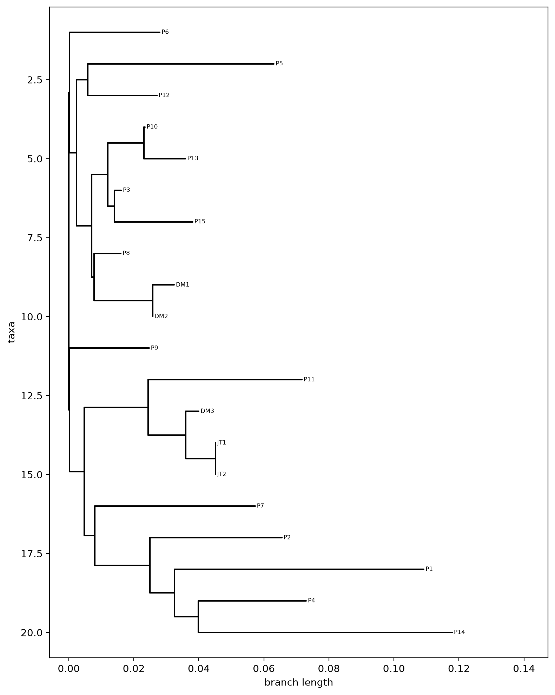

# BINF6250 - Project 06

# Introduction
This project implements a distance-based phylogenetic tree builder that applies the Neighbor-Joining algorithm to 20 HIV-1 reverse transcriptase (RT) protein sequences, each 229 amino acids long, from `lafayette_SARS_RT.fasta`. Every pair of sequences is aligned with the Smith-Waterman local alignment algorithm (match +2, mismatch −1, gap −1), and the best local score is normalized by the score of a perfect match of the shorter sequence, giving a similarity between 0 and 1. Each similarity is converted to a distance (`distance = 1 - similarity`) to build a symmetric 20 × 20 distance matrix. Neighbor-Joining then repeatedly joins the pair of nodes with the lowest D* (Q) score, calculates the two new branch lengths, and replaces the pair with a new node in a smaller matrix until two nodes remain. The result is an unrooted tree, written in Newick format and plotted with Biopython and Matplotlib. Neighbor-Joining was chosen over UPGMA because it does not assume a constant rate of evolution across lineages, so branch lengths can differ between sequences.

All required functionality described in the assignment instructions was completed. The `read_fasta()`, `smith_waterman()`, `build_distance_matrix()`, and `neighbor_joining()` functions were implemented, and the full pipeline runs in under a minute and produces a tree containing all 20 sequences. The Neighbor-Joining implementation was also tested on the 4-sequence example matrix from class, where it recovered the expected branch lengths of 11, 2, 6, 7, and 4.

# How it works
Read the data: sequences are loaded from a FASTA file(`lafayette_SARS_RT.fasta`).
Score pairs: every pair of sequences is aligned with Smith-Waterman.The best local score is normalized to a value   between 0 and 1, where 1 means a perfect match.
Build distances: each similarity is converted to a distance(`distance = 1 - similarity`), giving a symmetric distance matrix.
Join neighbors: Neighbor-Joining repeatedly merges the pair of nodes with the smallest Q-value and updates the distance matrix until two nodes remain.
Draw the tree: the result is written in Newick format and plotted with Biopython and Matplotlib.

# Files

- project06.ipynb - notebook with the implementation
- lafayette_SARS_RT.fasta -input sequences
- nj_tree.png - image of the final tree, shown in Results Output

# Requirements

Python 3, `numpy`, `matplotlib`, and `biopython`:

    pip install numpy matplotlib biopython

# Usage

Place the FASTA file in the same folder as the notebook, open it in VS Code or Jupyter, and choose **Run All**. The final cell reads the sequences, builds the distance matrix, runs Neighbor-Joining, and plots the tree.

# Pseudocode
def read_fasta(filename: str) -> Dict[str, str]:
    sequences = empty dictionary (name to sequence)
    current_name = nothing yet

    Open the file and read it line by line:
        strip spaces and the newline off the end of the line
        IF the line is empty:
            skip it
        IF the line starts with ">":
            current_name = last word of the line (i.e. "DM1")
            sequences[current_name] = empty string
        ELSE (it's part of a sequence):
            add the line to the end of sequences[current_name]

    Return sequences

Changes from Project 05 smith_waterman:
    1. cal_score is kept as-is; it still calculates each cell's score. The traceback arrow it records is not used here.
    2. Drop traceback, along with the traceback_matrix lines and the max_pos line, since nothing uses them anymore.
    3. Keep the original table-filling loop and the best_score line in a helper function, and remove both print statements.
    4. smith_waterman uses the Project 06 name and inputs, calls the helper, and returns the normalized score:
       normalized = raw(seq1, seq2) / smaller of [raw(seq1, seq1), raw(seq2, seq2)]

def cal_score(matrix, seq1, seq2, i, j, match, mismatch, gap):  #Original calc_score from Project05 untouched.  Needed to run Smith_Waterman function from Project05

def project5_smith_waterman_score(seq1, seq2, match, mismatch, gap):  #Original smith_waterman function from Project05, turned into a helper function for the new smith_waterman function in Project06

def smith_waterman(
    sequence1: str,
    sequence2: str,
    match_score: float = 2.0,
    mismatch_penalty: float = -1.0,
    gap_penalty: float = -1.0
) -> float:
    raw_score = project5_smith_waterman_score(sequence1 vs sequence2, using match_score, mismatch_penalty, gap_penalty)
    self_score1 = project5_smith_waterman_score(sequence1 vs sequence1, same scores)
    self_score2 = project5_smith_waterman_score(sequence2 vs sequence2, same scores)

    smaller_self_score = smaller of self_score1 and self_score2

    IF smaller_self_score is 0 (only happens if a sequence is empty):
        return 0.0 (avoids dividing by zero)
    
    Return (raw_score / smaller_self_score) Note: 1.0 = identical, closer to 0 = less similar

def build_distance_matrix(sequences: Dict[str, str]) -> Tuple[np.ndarray, List[str]]:
    ids = list of the sequence names, in file order (i.e. ["DM1", "DM2", ...])
    n = number of sequences
    distance_matrix = n x n grid of zeros (diagonal stays 0: each sequence vs itself)

    For each row i from 0 to n-1:
        FOR each column j from i+1 to n-1 (only pairs not yet done; skip the diagonal):
            similarity = smith_waterman (sequence for ids[i], sequence for ids[j])
            distance = 1 - similarity
            distance_matrix[i, j] = distance
            distance_matrix[j, i] = distance  (Table is symmetric, so fill both halves)

    Return distance_matrix, ids

def neighbor_joining(
    distance_matrix: np.ndarray,
    labels: List[str]
) -> str:
    PROPOSAL FOR DECISIONS IN PSEUDOCODE/CODE
        Final branch between the last two nodes is split evenly between them
        Branch lengths are written to 4 decimals places in the Newick text (calculations use full precision)
        All 20 sequences are used.  The docstring expects 19, note it in README
        Ties in the D* score: the first pair found is kept
        Negative branch lengths: set to 0, differences added to the other branch
        
    SETUP
    D = copy of distance_matrix (so original table isn't changed)
    current_labels = copy of labels (each starts as just a name, i.e. "DM1")

    WHILE more than 2 nodes remain:
        n = number of rows in D

        Step 1. Total Distance:  totals = sum of each for row of D

        Step 2. D* score for every pair, keep the lowest:  lowest_score = a very large number
        FOR each row i from 0 to n-1:
            FOR each column j from i+1 to n-1:
                score = (n-2) * D[i, j] - totals[i] - totals[j]
                IF score < lowest_score:
                    lowest_score = score
                    best_i = i
                    best_j = j

        Step 3. Branch lengths for best_i and best_j
        branch_i = (D[best_i, best_j] + (totals[best_i] - totals[best_j]) / (n-2)) / 2
        branch_j = D[best_i, best_j] - branch_i
        IF either branch is negative:
            set it to 0 and add the difference to the other branch
        
        Step 4. Distances from the new node to every other node k
        new_distances = empty list
        FOR each k that is not best_i or best_j:
            new_distances.append((D[best_i, k] + D[best_j, k] - D[best_i, best_j]) / 2)

        New_label for the joined pair:
        new_label = "(" + current_labels[best_i] + ":" + f"{branch_i:.4f}" + "," + current_labels[best_j] + ":" + f"{branch_j:.4f}" + ")"

        Step 5. Shrink the table
        keep = every index except best_i and best_j
        new_D = (n-1) x (n-1) grid of zeros
        copy D's row/columns for the kept indices into the top left of new_D
        put new_distances in the last row and last column of new_D (new node goes last)
        current_labels = labels at the kept indices, then new_label added at the end
        D = new_D

    Step 6. Exactly 2 nodes left: connect them  (The final branch is split evenly between two sides so the tree can be drawn)
    final_distance = D[0, 1] / 2
    tree = "(" + current_labels[0] + ":" + f"{final_distance:.4f}" + "," + current_labels[1] + ":" + f"{final_distance:.4f}" + ");"

    Return tree    

# Results Output



Newick output from `neighbor_joining()`:

```
((P6:0.0278,((P5:0.0573,P12:0.0213):0.0034,(((P10:0.0003,P13:0.0128):0.0111,(P3:0.0021,P15:0.0241):0.0020):0.0050,(P8:0.0082,(DM1:0.0066,DM2:0.0000):0.0180):0.0008):0.0046):0.0022):0.0002,(P9:0.0245,((P11:0.0473,(DM3:0.0040,(JT1:0.0000,JT2:0.0000):0.0091):0.0116):0.0196,(P7:0.0493,(P2:0.0405,(P1:0.0767,(P4:0.0332,P14:0.0781):0.0073):0.0075):0.0170):0.0032):0.0046):0.0002);
```

The tree contains all 20 HIV-1 reverse transcriptase sequences. Overall, the sequences are highly similar: the largest pairwise distance in the matrix is 0.183, so most branches are short. JT1 and JT2 join with branches of length 0 because their sequences are identical, and DM1 and DM2 form the closest pair, with DM2's branch also at 0 (a tiny negative rounding error set to 0). DM3 does not group with DM1 and DM2; it clusters with JT1 and JT2 instead. The longest terminal branches belong to P14 (0.0781) and P1 (0.0767), meaning these sequences differ most from their nearest relatives in the tree. Because Neighbor-Joining produces an unrooted tree, the split at the far left of the plot (where the final branch was divided evenly) is not a true common ancestor; only the groupings and branch lengths are meaningful.

# Successes
The notebook reads the FASTA file, builds the distance matrix, runs Neighbor-Joining, and draws the tree. Running
Run All on the real data set produced a plotted phylogenetic tree with the sequence IDs as leaf labels.Instead of rewriting the alignment, we kept  `cal_score` function from project05 and wrapped it in the `smith_waterman` function that returned a single normalized score between 0 and 1.Dividing the best local score by the score of a perfect match of the shorter sequence meant identical sequences gave a similarity of exactly 1.0, which matched the docstring example and made the conversion to a distance (`1 - similarity`) simple.

# Struggles
Missing packages: The notebook failed at the import cell with `ModuleNotFoundError: No module named 'matplotlib'`. Installing `matplotlib` and `biopython` with `%pip install` inside the notebook, then restarting the kernel, fixed it. Installing from inside the notebook ensures the packages go into the same Python environment the notebook runs on.

A near-zero negative branch: DM2's branch length came out as a tiny negative number (a floating-point rounding error) and was set to 0, so DM2 appears with no visible branch in the plot.


# Reflection and Adaptive Learning

# Personal Reflections
## Group leader
I could follow the Neighbor-Joining formulas, but I didn't fully understand why subtracting the row sums in the Q-matrix picks out true neighbors instead of just the two closest sequences. I also wasn't sure what it means when the algorithm produces negative branch lengths. I set them to zero so the tree would plot, but that hides the fact that my distances don't fit a perfect tree,and I don't know how much that affects the result. Finally, I converted Smith-Waterman scores into distances using `distance = 1 - normalized score`,and I'm not sure how well that simple formula represents real evolutionary distance.

## Other member

## Other member:  Ildiko Polyak
The most valuable part of this project for me was comparing our three individual versions of the code. We all started from the same pseudocode, yet the three implementations ended up looking very different: different ways of normalizing the Smith-Waterman score, of shrinking the distance matrix, and of building the Newick string. Running my version side by side with the final group version and confirming they produced identical distance matrices and an identical tree showed me that very different code can implement the same algorithm correctly. Since I'm still a beginner at coding, reading how others solved the same problem taught me techniques I wouldn't have found on my own, like normalizing with a single alignment instead of three and using array operations to resize the matrix. It also showed me how much clear comments matter, code without them took me much longer to understand, even when it was well written.

I'll admit that evolution and phylogeny have never been topics that interest me much (BO-RING). What did catch my interest was applying the method to HIV reverse transcriptase sequences and comparing viral variants. It was a good lesson that the same algorithm can serve very different biological questions, from evolutionary history to tracking viral strains and drug resistance.

# Generative AI Appendix
Anthropic Claude Opus 5.5 prompt: "How do I add an phylogenetic tree image result output from my .ipynb file into my README.md file?"
Claude was also used to adapt the Smith-Waterman function from project05
